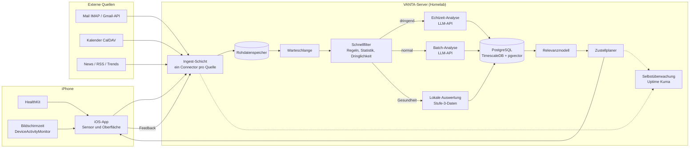

# VANTA: Projektleitfaden und Roadmap

> Persönliches Projekt, ausgelegt auf einen bis zwei Nutzer (höchstens drei aus der Familie). Betrieb auf eigener Hardware, siehe Abschnitt 13.
> Dieses Dokument beschreibt Ziel, Grundprinzipien, Architektur und Meilensteine. Es ist bewusst als Richtung gedacht, nicht als fertige Spezifikation. Details werden pro Meilenstein konkretisiert.

---

## 1. Vision

VANTA ist ein proaktiver persönlicher Assistent, der Daten aus vielen Quellen (Gesundheit, Mail, Kalender, Nachrichten, Bildschirmzeit, eigenes Nutzungsverhalten) sammelt, miteinander verknüpft und dem Nutzer **zum richtigen Zeitpunkt, in der richtigen Form** das Wichtige liefert.

Kein starrer Tagesbericht, sondern:

- **Trends erkennen:** z. B. Stress steigt seit zwei Wochen deutlich über den persönlichen Normalwert.
- **Themen weiterverfolgen:** z. B. vor zwei Wochen über einen Raub gelesen, jetzt gibt es ein Urteil, also Update.
- **Kreuzverweise herstellen:** Mail, Termin, Person und Nachricht hängen zusammen.
- **Den Nutzer kennenlernen:** was interessiert, was nicht, wann und wie Informationen am besten ankommen.

Das System lebt von seinen vielen Sensoren und der Kombination ihrer Daten. Den Großteil der Zeit geht es um Routine (Schlaf, News, Tagesbriefing). Gesundheitliche Auffälligkeiten oder eine Flut wichtiger Mails sind selten, müssen dann aber zuverlässig erkannt werden.

---

## 2. Grundprinzipien

Diese Regeln gelten für jede Entscheidung im Projekt.

1. **Informationen dürfen nie fehlen.** Jede eingehende Information wird zuerst unverändert gespeichert und erst danach verarbeitet. Nichts verschwindet still.
2. **Stille ist kein "alles in Ordnung".** Liefert ein Sensor nicht wie erwartet, ist das ein Fehler und wird gemeldet.
3. **Lernen für die Routine, feste Regeln für das Seltene.** Seltene, wichtige Ereignisse (Gesundheit, dringende Mails) laufen über feste, selbst definierte Schwellwerte, die das System nicht wegkalibrieren darf.
4. **Ehrlichkeit vor Vollständigkeit.** Fehlen Daten, sagt das System das, statt Aussagen aus Lücken abzuleiten.
5. **Datenschutz nach Stufen.** Sensible Daten werden getrennt und verschlüsselt gespeichert. Gesundheitsdaten verlassen den eigenen Server nicht.
6. **Batch zuerst.** Was warten kann, wird gebündelt und günstig verarbeitet. Echtzeit nur für Dringendes.
7. **Nachvollziehbarkeit.** Jede Meldung kann begründen, warum sie kommt. Jede Aktion der KI wird protokolliert.
8. **Nur lesen, nicht handeln.** Aktionen mit Außenwirkung (Senden, Löschen, Antworten) nur nach Bestätigung durch den Nutzer.
9. **Mandantenfähig vorbereitet.** Auch wenn es nur einen Nutzer gibt: Nutzer-ID von Anfang an in jeder Tabelle und jedem Schlüssel.

---

## 3. Architekturüberblick

### Komponenten

| Komponente | Aufgabe |
|---|---|
| **iOS-App** | Erfasst nur, was keine andere Schnittstelle liefert: Reaktion auf eigene Meldungen, Lesedauer, Bildschirmzeit nach Kategorien, Standortwechsel. Zeigt Briefings, Graphen und Chat. Ist Nachrichtenleser, damit Leseverhalten messbar wird. |
| **Ingest-Schicht** | Ein kleiner Dienst pro Quelle. Holt Daten, vereinheitlicht sie, speichert sie roh und schreibt sie in die Warteschlange. Fällt ein Connector aus, läuft der Rest weiter. |
| **Schnellfilter** | Läuft sofort bei jeder neuen Information, ohne Sprachmodell. Stuft Dringlichkeit, Sensibilität und Themenbezug ein. Über 90 Prozent der Daten werden hier nur gespeichert. |
| **Analyse** | Echtzeit-API für Dringendes, Batch-API für alles andere, lokale Auswertung für Gesundheitsdaten. |
| **Datenbank** | Rohdaten, Zeitreihen, Embeddings, Themenliste, Wissensgraph, Nutzerprofil, Feedback. |
| **Relevanzmodell** | Kleines, regelmäßig neu trainiertes Modell, das aus Feedback lernt, was interessiert und wann. |
| **Zustellplaner** | Entscheidet Zeitpunkt, Kanal (Push oder stille Anzeige) und Form (Text, Grafik, kurz, ausführlich). Hält das Push-Budget ein. |
| **Selbstüberwachung** | Prüft Sensoren, Datenplausibilität, Verarbeitung und Zustellung. |

### Technik

| Bereich | Entscheidung |
|---|---|
| Server-Hardware | eigener Mini-PC nur für VANTA (Modell noch offen) |
| Betriebssystem | Debian minimal |
| Betrieb | Docker Compose |
| Server-Sprache | Python (FastAPI für Schnittstellen) |
| Datenbank | PostgreSQL mit TimescaleDB (Zeitreihen) und pgvector (semantische Suche) |
| Warteschlange | Zunächst auf PostgreSQL-Basis, später bei Bedarf Redis |
| Sprachmodell | Externe API mit Batch-Modus und Prompt Caching |
| Lokale Auswertung | Statistik, bei Bedarf kleines lokales Modell |
| Verbindung App und Server | Cloudflare Tunnel, Geräte-Authentifizierung, Allowlist, strenge Schemas (siehe SECURITY.md) |
| Verwaltung | ausschließlich über Tailscale |
| App | Swift / SwiftUI, Build über GitHub Actions (macOS-Runner), Installation über SideStore |
| Benachrichtigungen | Lokale Benachrichtigungen der App, Apple Push erst mit bezahltem Entwickleraccount |
| Überwachung | eigener Status-Endpunkt mit Anzeige in der App, Uptime Kuma von außen |
| Lizenz | AGPL-3.0 |

---

## 4. Datenquellen

| Quelle | Weg | Erwartete Frequenz | Sensibilität |
|---|---|---|---|
| Schlaf, Puls, HRV, Stress, Gewicht, Schritte | HealthKit über die App, Hintergrundzustellung | je nach Wert minütlich bis täglich | Stufe 3 |
| Bildschirmzeit nach Kategorie | DeviceActivityMonitor-Schwellwerte, App Group, App, Server | alle paar Minuten bei Nutzung | Stufe 2 |
| Reaktion auf eigene Meldungen | App | bei jeder Meldung | Stufe 2 |
| Leseverhalten (Artikel, Lesedauer) | App als Nachrichtenleser, Teilen-Erweiterung | bei Nutzung | Stufe 2 |
| Standortwechsel | App, signifikante Ortswechsel | bei Ortswechsel | Stufe 2 |
| Mail | Server, IMAP oder Gmail-API | laufend | Stufe 2 |
| Kalender | Server, CalDAV oder App über EventKit | laufend | Stufe 2 |
| Nachrichten, Trends | Server, RSS und Nachrichtenquellen | stündlich | Stufe 1 |

---

## 5. Datenhaltung

### Sensibilitätsstufen

| Stufe | Beispiele | Speicherung | Verarbeitung |
|---|---|---|---|
| 1 | Nachrichten, Welttrends | normal | externe API |
| 2 | Mails, Termine, Nutzungsverhalten | verschlüsselt, Schlüssel getrennt | externe API |
| 3 | Gesundheitsdaten | verschlüsselt, separat | nur lokal |

### Lebenszyklus

- **Bewertung beim Eintragen** nach mehreren Kategorien: Wichtigkeit, Ablauf, Sensibilität, Datum, Themenbezug.
- **Zerfallsfunktion statt ständiger Neubewertung:** Die aktuelle Wichtigkeit wird bei der Abfrage aus Grundwert und Alter berechnet. Neu bewertet wird nur, wenn ein Ereignis einen Datensatz wieder relevant macht.
- **Verdichten statt löschen** bei Zeitreihen: Minutenwerte 30 Tage, Stundenwerte 1 Jahr, Tageswerte unbegrenzt.
- **Erkenntnis behalten, Rohdaten verwerfen** bei Texten: Die Mail verfällt nach definierter Halbwertszeit, die daraus gewonnene Information bleibt.
- **Unwichtiges und Abgelaufenes** wird nach definierter Halbwertszeit gelöscht.

### Besondere Datentypen

- **Themenliste:** Offene Themen, die den Nutzer interessiert haben und weiterverfolgt werden (Beispiel Raub und späteres Urteil).
- **Wissensgraph:** Personen, Orte, Themen und Ereignisse als verknüpfte Knoten. Grundlage für Kreuzverweise.
- **Nutzerprofil:** Lesbare, vom System gepflegte Beschreibung von Interessen und Vorlieben. Vom Nutzer einsehbar und korrigierbar.
- **Feedback:** Jede Zustellung mit Zeitpunkt, Form, Kanal, Reaktion, Reaktionszeit, Lesedauer und Bewertung.
- **Protokoll:** Was hat die KI wann und warum getan.

### Backup

- [x] Tägliches, verschlüsseltes Backup (Skript und Anleitung in docs/BACKUP.md, Einrichtung per Cron auf dem Server steht noch aus)
- [ ] Zweite Kopie an einem externen Ort
- [ ] Wiederherstellung regelmäßig testen

---

## 6. Verarbeitung

### Prioritätsklassen

| Klasse | Beispiele | Verarbeitung |
|---|---|---|
| **Sofort** | starke Gesundheitsausreißer, Mail von Personen auf der Wichtig-Liste, kurzfristig geänderte Termine | Echtzeit-API, sofortige Zustellung |
| **Nächstes Zeitfenster** | neue Artikel, normale Mails, Updates zu offenen Themen | gesammelt, Batch vor dem nächsten Zeitfenster |
| **Hintergrund** | Wochentrends, Profilpflege, Neubewertung, Training des Relevanzmodells | nachts als Batch |

### Zeitfenster und Annahmeschluss

Zeitfenster werden zu Beginn fest vorgegeben und später aus dem Verhalten gelernt.

| Zeitfenster | Startwert | Annahmeschluss für Batch |
|---|---|---|
| Morgenbriefing | 07:00 | nachts |
| Pause | 12:30 | ca. 10:30 |
| Abend | 21:00 | ca. 18:00 |

- Was nach dem Annahmeschluss eintrifft, kommt ins nächste Fenster, außer es ist dringend.
- Kommt ein Batch nicht rechtzeitig zurück, wird automatisch auf Echtzeit umgeschaltet.
- **Aktualitätscheck** direkt vor der Zustellung: Gibt es seit der Berechnung Neues zu den Themen? Wenn ja, nur diesen Punkt nachberechnen.
- **Vorberechnen, spät zusammensetzen:** Inhalte werden im Batch analysiert, Form und Kanal erst beim Ausliefern festgelegt.

### Dringlichkeitsprüfung

Läuft sofort bei jeder neuen Information und ist das kritischste Element der Verarbeitung. Im Zweifel lieber einmal zu oft als dringend einstufen.

---

## 7. Zustellung und Kalibrierung

### Ablauf

1. **Startphase (erste Tage bis Wochen):** feste Standardwerte für Zeitfenster, Form, Länge und Themen.
2. **Lernphase:** Sobald genug Feedback vorliegt, übernimmt das Relevanzmodell schrittweise.
3. **Laufende Anpassung:** Lässt die Aufmerksamkeit nach, wird nachjustiert.

### Regeln für stabile Kalibrierung

- **Gezielt ausprobieren:** Ein kleiner Anteil der Meldungen wird bewusst anders zugestellt (Zeit, Form, Kanal), damit das System nicht im ersten Optimum hängen bleibt.
- **Ursachen trennen:** Kalender und Bildschirmzeit als Kontext nutzen, damit "keine Zeit" nicht mit "kein Interesse" verwechselt wird.
- **Feste Regeln sind tabu:** Gesundheits- und Dringlichkeitsregeln werden nie durch Lernen abgeschwächt.
- **Push-Budget:** Obergrenze pro Tag plus Ruhezeiten. Ausnahme nur für echte Dringlichkeit.
- **"Warum sehe ich das?":** Jede Meldung liefert ihre Begründung mit.

### Gesundheit

- Formulierungen relativ zum persönlichen Normalwert, keine Diagnosen.
- Bei deutlichen Ausreißern Hinweis auf ärztliche Abklärung.

---

## 8. Selbstüberwachung

| Prüfung | Beschreibung |
|---|---|
| **Erwartungswert pro Sensor** | Jede Quelle hat eine erwartete Frequenz. Bleibt sie länger stumm, gibt es Alarm. Umsetzung über Push-Monitore in Uptime Kuma. |
| **Plausibilität** | Unplausible Werte erkennen, z. B. nur 2 Stunden Schlaf bei getragener Uhr, tagelang identisches Gewicht, null Mails an einem Werktag. |
| **Kein Datenverlust** | Rohdaten zuerst speichern. Fehlgeschlagene Verarbeitung landet in einer Fehlerwarteschlange und wird wiederholt. Doppelte Verarbeitung bleibt folgenlos. |
| **Abgleich mit der Quelle** | Regelmäßig Anzahl der Datensätze mit der Quelle vergleichen und bei Abweichung nachladen. |
| **Ende-zu-Ende-Test** | Täglich eine Testnachricht durch die gesamte Kette bis aufs Handy schicken. |
| **Ehrliches Briefing** | Fehlende Daten werden im Briefing benannt. |

---

## 9. Meilensteine

Jeder Meilenstein endet mit einem lauffähigen, nutzbaren Stand.

### M0: Grundlagen

- [ ] Öffentliches Repository mit LICENSE (AGPL-3.0), Secret Scanning und Push Protection
- [ ] Commit-E-Mail auf GitHub-Noreply-Adresse gestellt
- [x] Pre-Commit-Check auf Schlüssel (gitleaks, `.pre-commit-config.yaml`)
- [x] Repository-Struktur (Server, App, Doku, config.example)
- [ ] Mini-PC mit Debian minimal, SSH nur mit Schlüssel, automatische Sicherheitsupdates
- [ ] Tailscale für die Verwaltung
- [ ] Netzsegment bzw. Firewall: kein Zugriff vom VANTA-Server ins Heimnetz
- [x] Docker Compose mit PostgreSQL, TimescaleDB, pgvector
- [x] Datenmodell Version 1: Rohdaten, Zeitreihen, Feedback, Protokoll, Nutzer-ID überall
- [x] Warteschlange und Fehlerwarteschlange
- [x] Verschlüsselung nach Stufen, Schlüsselverwaltung
- [ ] Backup eingerichtet und Wiederherstellung getestet
- [x] Status-Endpunkt (Quellen online/offline, letzter Sync, Warteschlange, letztes Backup)
- [ ] Uptime Kuma überwacht VANTA von außen

**Fertig, wenn:** Testdaten eingespeist, gespeichert, verarbeitet und aus dem Backup wiederhergestellt werden können.

### M1: App-Grundgerüst und Gesundheitsdaten

- [x] GitHub-Actions-Workflow baut (Vorlage in docs/, ungetestet) die App auf einem macOS-Runner als unsignierte .ipa
- [ ] Installation und automatische Neusignierung über SideStore
- [ ] Öffentliche Schnittstelle über Cloudflare Tunnel mit Gateway, Allowlist und Schemas
- [ ] Geräte-Authentifizierung mit Schlüssel aus der Secure Enclave, Registrierung über Tailscale
- [ ] SwiftUI-App mit Statusanzeige (Online/Offline, letzter Sync)
- [ ] Zwischenspeicher in der App: nichts geht verloren, wenn der Server nicht erreichbar ist (Gesundheitsdaten lokal gepuffert, Upload steht aus)
- [x] HealthKit-Anbindung mit Hintergrundzustellung (lokal, Test über SideStore auf dem Gerät steht aus)
- [x] Lokale Benachrichtigungen: planbare Meldungen werden vorab terminiert (Test auf dem Gerät steht aus)
- [x] Feedback-Erfassung für eigene Meldungen (zugestellt, geöffnet, weggewischt, Reaktionszeit; Test auf dem Gerät steht aus)
- [ ] Erste Trendlogik: persönlicher Normalwert und Abweichung für Schlaf und Stress
- [ ] Sensor-Überwachung für Gesundheitsdaten

**Fertig, wenn:** Eine echte Abweichung im Schlaf oder Stress automatisch als Benachrichtigung ankommt und fehlende Gesundheitsdaten gemeldet werden.

### M2: Nachrichten und Themenverfolgung

- [ ] News-Connector (RSS und weitere Quellen)
- [ ] Nachrichtenleser in der App mit Messung der Lesedauer
- [ ] Teilen-Erweiterung für Artikel aus anderen Apps
- [ ] Embeddings und semantische Suche
- [ ] Themenliste mit automatischer Folgesuche
- [ ] Gemeinsame Analyse pro Artikel, Relevanz pro Nutzer

**Fertig, wenn:** Ein gelesenes Thema Tage später automatisch ein Update auslöst, sobald es Neuigkeiten gibt.

### M3: Mail, Kalender und Morgenbriefing

- [ ] Mail-Connector (IMAP oder Gmail-API)
- [ ] Kalender-Connector
- [ ] Wichtig-Liste für Personen und Absender
- [ ] Prioritätsklassen und Dringlichkeitsprüfung
- [ ] Batch-Verarbeitung mit Annahmeschluss und Rückfall auf Echtzeit
- [ ] Prompt Caching für Profil und Systemanweisungen
- [ ] Morgenbriefing, Pausenbriefing, Abendbriefing mit festen Startwerten
- [ ] Aktualitätscheck vor der Zustellung

**Fertig, wenn:** Drei Briefings pro Tag zuverlässig ankommen und dringende Mails sofort gemeldet werden.

### M4: Bildschirmzeit und Kontext

- [ ] Bezahlter Apple-Entwickleraccount (Voraussetzung für Family Controls und Apple Push)
- [ ] Umstellung auf Apple Push für dringende Meldungen
- [ ] Family-Controls-Berechtigung
- [ ] DeviceActivityMonitor mit Schwellwerten pro Kategorie
- [ ] Übertragung über App Group zur App und zum Server
- [ ] Bereinigung doppelter Schwellwertereignisse
- [ ] Standortwechsel als Kontext
- [ ] Tagesprofil: wann am Handy, informativ oder Freizeit

**Fertig, wenn:** Das System erkennt, ob gerade Arbeit, Pause oder Freizeit ist, und das im Zustellplaner nutzt.

### M5: Lernen und Kalibrierung

- [ ] Relevanzmodell auf Basis des gesammelten Feedbacks
- [ ] Nächtliches Neutraining
- [ ] Gelernte Zeitfenster ersetzen Startwerte schrittweise
- [ ] Gezieltes Ausprobieren alternativer Zustellungen
- [ ] Push-Budget und Ruhezeiten
- [ ] Nutzerprofil als lesbare Datei, in der App einsehbar und korrigierbar
- [ ] "Warum sehe ich das?" bei jeder Meldung

**Fertig, wenn:** Öffnungsrate und Lesedauer gegenüber der Startphase messbar steigen.

### M6: Wissensgraph und Kreuzverweise

- [ ] Erkennung von Personen, Orten, Themen und Ereignissen
- [ ] Verknüpfung über alle Quellen
- [ ] Kreuzverweise in Briefings (Mail, Termin, Person, Nachricht)
- [ ] Langzeittrends über Wochen und Monate, quellenübergreifend

**Fertig, wenn:** Briefings regelmäßig Zusammenhänge zwischen verschiedenen Quellen herstellen, die ohne System nicht aufgefallen wären.

### M7: Härtung

- [ ] Abgleich mit Quellen und automatisches Nachladen
- [ ] Täglicher Ende-zu-Ende-Test
- [ ] Plausibilitätsprüfungen für alle Sensoren
- [ ] Vollständiges Aktionsprotokoll
- [ ] Sicherheitsprüfung gegen manipulierte Inhalte in Mails und Artikeln (Prompt Injection)
- [ ] Dokumentation für Betrieb und Wiederherstellung

**Fertig, wenn:** Das System einen Monat ohne unbemerkten Datenverlust läuft.

---

## 10. Bekannte Einschränkungen

- **iOS-Sandbox:** Inhalte und Benachrichtigungen anderer Apps sind für die eigene App nicht sichtbar. Messbar ist nur die Reaktion auf eigene Meldungen.
- **Bildschirmzeit:** Detaildaten aus DeviceActivityReport können die Erweiterung nicht verlassen. Nutzbar sind nur Schwellwertereignisse über DeviceActivityMonitor, mit grober Auflösung und ohne App-Namen im Klartext.
- **WhatsApp:** Keine offizielle Schnittstelle für Privatnutzer. Inoffizielle Wege riskieren eine Sperrung der Nummer. Vorerst nicht vorgesehen.
- **Kostenloser Apple-Account (Personal Team):** Die Signatur gilt 7 Tage und wird von SideStore automatisch erneuert. Apple Push und Family Controls (Bildschirmzeit) sind damit nicht verfügbar. Bis M4 laufen Meldungen deshalb als lokale Benachrichtigungen. Planbare Meldungen wie Briefings kommen pünktlich, dringende Meldungen nur, wenn iOS die App im Hintergrund weckt, also mit möglicher Verzögerung.
- **Ohne Mac:** Kein Simulator, keine SwiftUI-Vorschau, kein Debugger. Jede Änderung läuft über einen Build in GitHub Actions.
- **Batch-Laufzeit:** bis zu 24 Stunden, deshalb Annahmeschluss und Rückfall auf Echtzeit nötig.

---

## 11. Offene Entscheidungen

- [ ] Exaktes Modell des Mini-PCs (Favorit: gebrauchter ThinkCentre M720q mit i5-8400T)
- [ ] Welcher LLM-Anbieter, welches Modell für Echtzeit und Batch
- [ ] Gmail-API oder IMAP
- [ ] Welche Nachrichtenquellen
- [ ] Halbwertszeiten pro Datenkategorie
- [ ] Schwellwerte für Gesundheitswarnungen
- [ ] Höhe des Push-Budgets und Ruhezeiten
- [ ] Lokales Modell für Stufe 3 oder reine Statistik

---

## 12. Hardware (ein bis zwei Nutzer)

| Bereich | Bedarf |
|---|---|
| Gerät | gebrauchter Mini-PC, z. B. Lenovo ThinkCentre M720q / M920q mit i5 (T-Modell) |
| CPU | 4 bis 6 Kerne |
| RAM | 8 GB reichen für den Start, 16 GB als spätere Aufrüstung |
| Speicher | SSD ab 256 GB; Zuwachs grob 5 bis 20 GB pro Nutzer und Jahr (Schätzung), plus Backup |
| GPU | nicht nötig bei API-Lösung |
| Betrieb | eigener Mini-PC nur für VANTA |

---

## 13. Betriebsmodell und spätere Erweiterung

### Heute

- VANTA läuft ausschließlich auf eigener Hardware im eigenen Netz.
- Nutzer: der Projektinhaber, bei Bedarf bis zu zwei weitere Familienmitglieder. Realistisch ein bis zwei Nutzer.
- Das iPhone erreicht den Server auch unterwegs über die abgesicherte Schnittstelle (siehe SECURITY.md). Verwaltung nur über Tailscale.

### Später: Umzug in die Cloud

Sollte VANTA tatsächlich von mehreren Nutzern verwendet werden, zieht das System auf einen Cloud-Server um (z. B. AWS). Damit das ohne Umbau möglich ist, gilt ab sofort:

1. **Portabel bleiben:** Keine Abhängigkeit von der Heimnetz-Hardware im Code. Alles läuft in Containern, alle Einstellungen kommen aus `.env` bzw. `config/`. Der Umzug besteht aus: Compose auf neuem Rechner starten, Datenbank übertragen, Serveradresse in der App ändern.
2. **Nutzertrennung von Anfang an:** Nutzer-ID in jeder Tabelle und jedem Schlüssel. Kein Nutzer kann Daten eines anderen sehen. Eigene Verschlüsselungsschlüssel pro Nutzer, spätestens bevor ein zweiter Nutzer dazukommt.
3. **Bewusste Entscheidung vor dem Umzug:** Das Prinzip "Gesundheitsdaten verlassen den eigenen Server nicht" muss neu bewertet werden. Bei Nutzern außerhalb der Familie gilt die DSGVO vollständig, Gesundheitsdaten sind besonders geschützt (Art. 9). Mögliche Lösungen: Rechenzentrum in der EU, Verschlüsselung mit Schlüsseln, die nur beim Betreiber bzw. Nutzer liegen.

Mandantentrennung, Schlüssel pro Nutzer, Rechteverwaltung und Datenschutz sind bei der Erweiterung der größte Aufwand, nicht die Rechenleistung.
